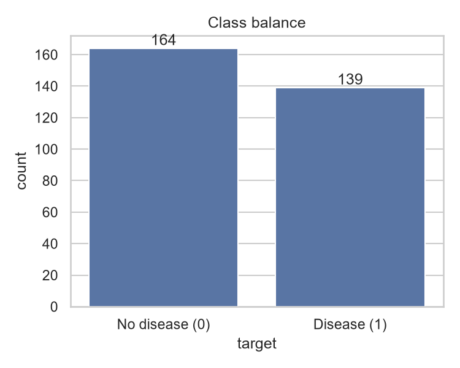
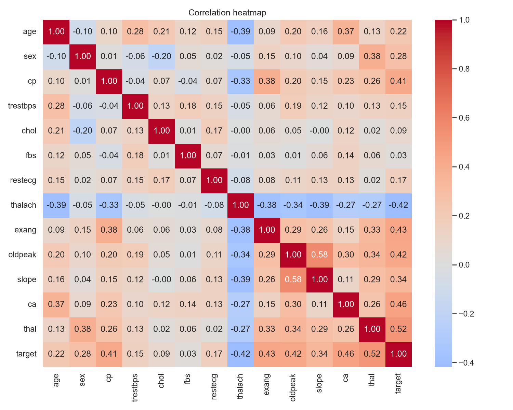
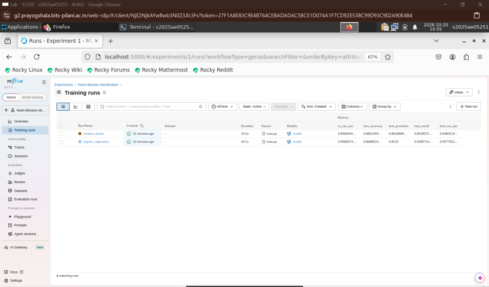
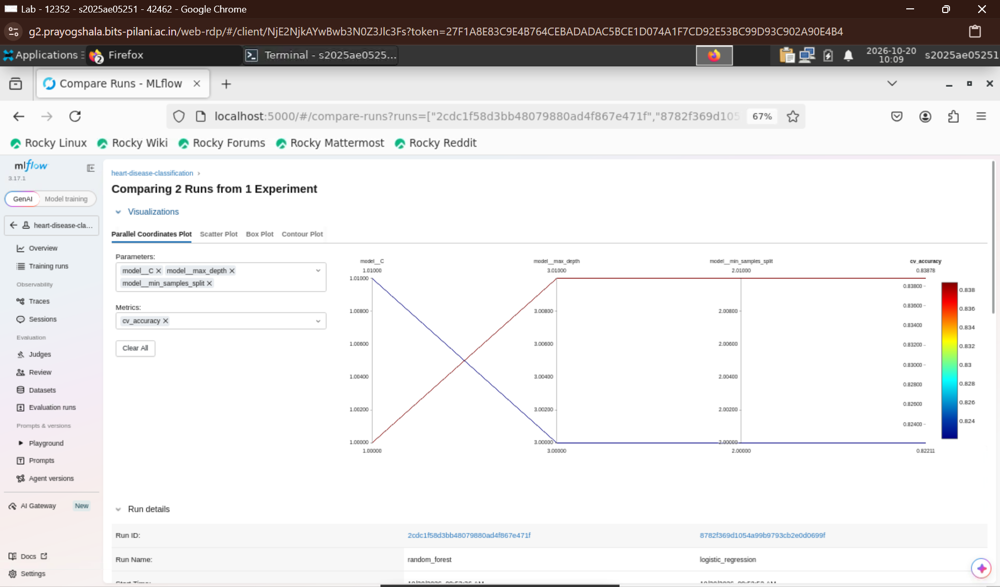
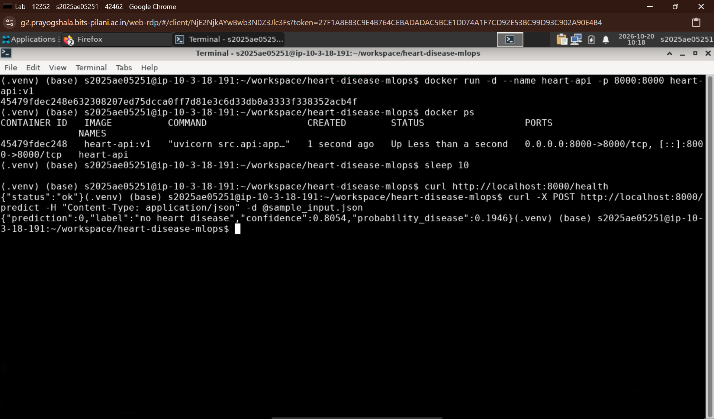
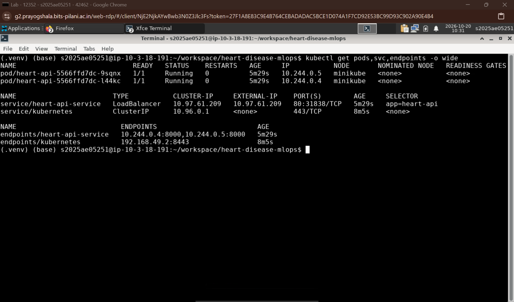
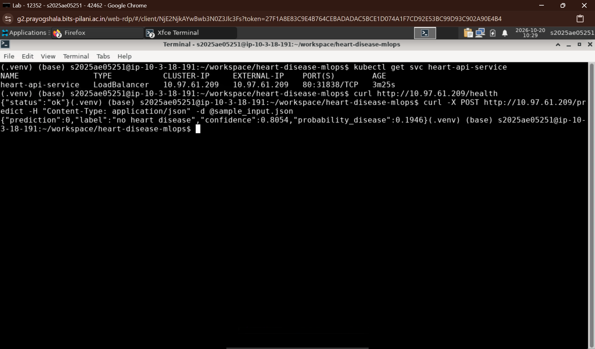
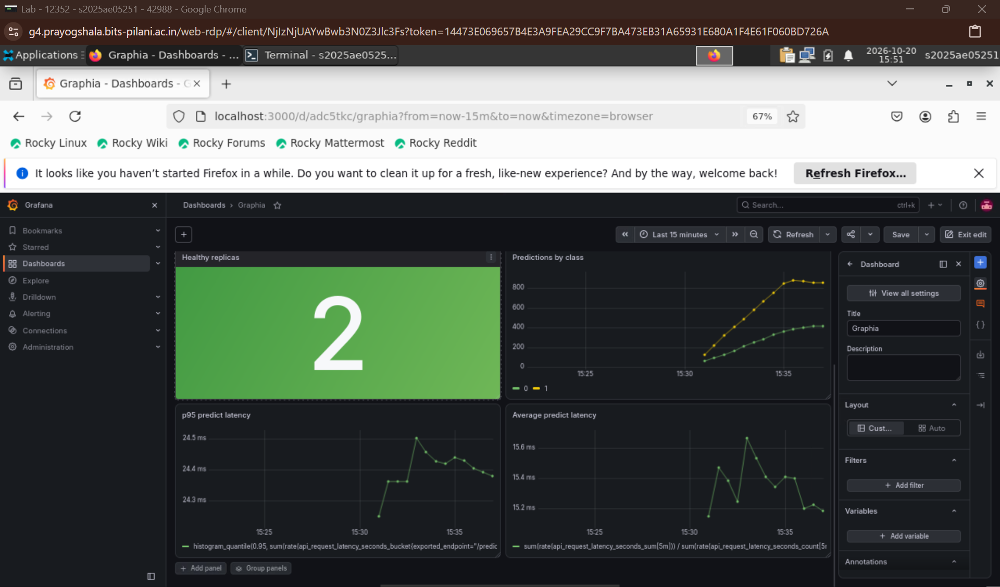
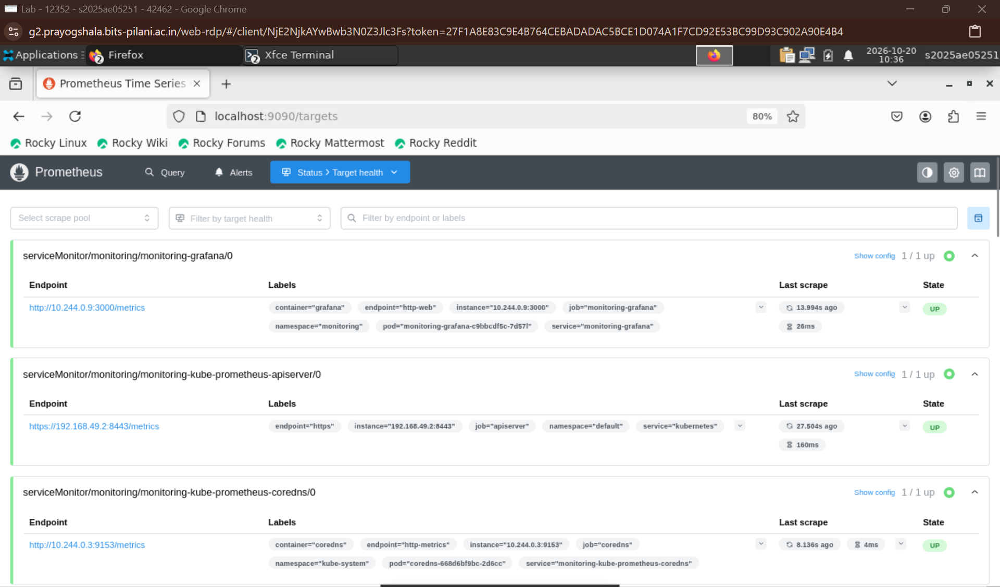
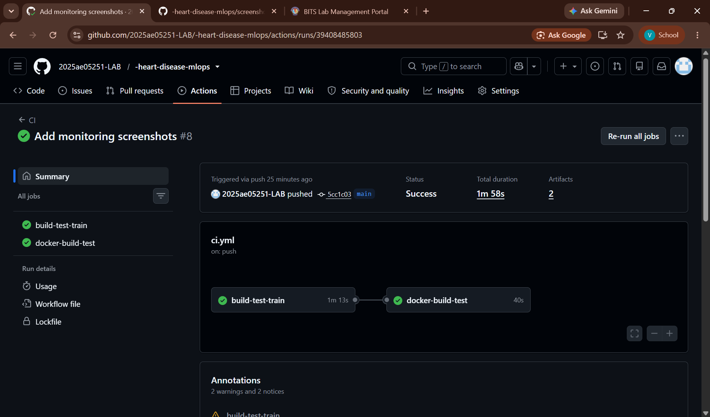

# Heart Disease Risk Prediction – End-to-End MLOps Pipeline

**Course:** MLOps (AIMLCZG523), BITS Pilani – Assignment 01
**Student:** [Your name here] (2025ae05251)

An end-to-end, reproducible machine learning pipeline that predicts the presence of heart disease from patient health data. It covers data acquisition, EDA, model training with experiment tracking, automated testing and CI, containerization, Kubernetes deployment, and monitoring.

- 📄 **Full report:** [2025ae05251_mlops_assignment1.docx](2025ae05251_mlops_assignment1.docx)
- 🎥 **Demo video:** [Watch the pipeline demo](https://drive.google.com/file/d/1dU582TEm_Sui5CwyYUseRREXGuwQUP6O/view?usp=sharing)
- 💻 **Code repository:** https://github.com/2025ae05251-LAB/-heart-disease-mlops

---

## 1. Dataset

Heart Disease UCI (Cleveland) dataset: 303 patients, 13 features and a target.
Source: [UCI Machine Learning Repository](https://archive.ics.uci.edu/dataset/45/heart+disease)

| Feature | Description |
|---|---|
| age | Age in years |
| sex | 1 = male, 0 = female |
| cp | Chest pain type |
| trestbps | Resting blood pressure (mm Hg) |
| chol | Serum cholesterol (mg/dl) |
| fbs | Fasting blood sugar > 120 mg/dl |
| restecg | Resting ECG result |
| thalach | Maximum heart rate achieved |
| exang | Exercise-induced angina |
| oldpeak | ST depression induced by exercise |
| slope | Slope of the peak exercise ST segment |
| ca | Number of major vessels colored by fluoroscopy |
| thal | Thalassemia test result |
| target | 0 = no disease, 1 = disease (original 0–4 severity binarised) |

**Cleaning steps** (`src/preprocess.py`): median imputation for `ca` (4 missing), mode imputation for `thal` (2 missing), duplicate removal, binarising the target. Final class balance: 164 healthy / 139 diseased.

---

## 2. Project Structure

```
├── src/
│   ├── download_data.py      # downloads UCI data -> data/raw/heart.csv
│   ├── preprocess.py         # cleaning -> data/processed/heart_clean.csv
│   ├── train.py              # training, tuning, MLflow logging, saves model
│   └── api.py                # FastAPI serving app (/predict, /health, /metrics)
├── notebooks/EDA.ipynb       # exploratory data analysis
├── data/raw, data/processed  # raw and cleaned datasets
├── models/                   # model.joblib, feature_columns.json, model_comparison.csv
├── tests/                    # test_data.py, test_model.py, test_api.py
├── k8s/                      # deployment.yaml, service.yaml
├── monitoring/               # servicemonitor.yaml, grafana-dashboard.json
├── scripts/generate_traffic.py   # load generator for the monitoring demo
├── .github/workflows/ci.yml  # GitHub Actions pipeline
├── Dockerfile
├── requirements.txt          # full dev environment
├── requirements-api.txt      # minimal serving environment (used in Docker)
├── sample_input.json         # sample request for /predict
├── screenshots/              # evidence for the report
└── 2025ae05251_mlops_assignment1.docx   # final report
```

---

## 3. Setup and Installation

Requires Python 3.14 (the version used in CI and in the Docker image).

```bash
git clone https://github.com/2025ae05251-LAB/-heart-disease-mlops.git
cd -heart-disease-mlops

python -m venv .venv
source .venv/bin/activate          # Windows: .venv\Scripts\activate
pip install -r requirements.txt
```

### Run the pipeline

```bash
python src/download_data.py        # download dataset
python src/preprocess.py           # clean dataset
python src/train.py                # train 2 models, log to MLflow, save best model
```

### Run tests and lint

```bash
flake8 src tests
pytest -v --cov=src
```

### View MLflow experiments

```bash
mlflow ui --backend-store-uri sqlite:///mlflow.db
# open http://localhost:5000
```

---

## 4. Modelling Summary

- **Features:** a scikit-learn `ColumnTransformer` inside the model pipeline. Numeric columns are standardised, nominal columns (`cp`, `restecg`, `slope`, `thal`) are one-hot encoded, and binary columns pass through.
- **Validation:** stratified 80/20 train/test split (random state 42). Hyper-parameters are tuned with `GridSearchCV` using stratified 5-fold CV on the training set, scored by ROC-AUC.
- **Models:** Logistic Regression and Random Forest.

| Model | Split | Accuracy | Precision | Recall | ROC-AUC |
|---|---|---|---|---|---|
| Logistic Regression | 5-fold CV | 0.839 | 0.877 | 0.766 | 0.907 |
| Random Forest | 5-fold CV | 0.822 | 0.826 | 0.783 | 0.897 |
| Logistic Regression | Hold-out test | 0.869 | 0.813 | 0.929 | 0.958 |
| Random Forest | Hold-out test | 0.885 | 0.862 | 0.893 | 0.948 |

**Final model: Logistic Regression** (best ROC-AUC, higher recall, simpler and faster). Best parameters: `C=1`, `penalty=l2`. The complete pipeline (preprocessing + model) is saved to `models/model.joblib`.

> Note: the dataset is small (61 test patients), so the difference between the two models is within noise. This project is a learning exercise and not a clinical tool.

### EDA highlights




---

## 5. Experiment Tracking (MLflow)

Experiment `heart-disease-classification` with one run per model. Logged for each run:

- **Parameters:** model type, CV folds, test size, tuned hyper-parameters
- **Metrics:** `cv_*` and `test_*` accuracy, precision, recall, ROC-AUC
- **Artifacts:** ROC curve, confusion matrix, and the full fitted pipeline




---

## 6. API

Built with FastAPI. Inputs are validated with Pydantic (invalid or missing fields return HTTP 422).

| Endpoint | Method | Description |
|---|---|---|
| `/predict` | POST | Takes a patient record, returns prediction, label, confidence |
| `/health` | GET | Health check (used by Kubernetes probes and CI) |
| `/metrics` | GET | Prometheus metrics |
| `/docs` | GET | Interactive Swagger UI |

**Example request** (`sample_input.json`):

```json
{
  "age": 63, "sex": 1, "cp": 3, "trestbps": 145, "chol": 233,
  "fbs": 1, "restecg": 0, "thalach": 150, "exang": 0,
  "oldpeak": 2.3, "slope": 0, "ca": 0, "thal": 1
}
```

**Example response:**

```json
{
  "prediction": 0,
  "label": "no heart disease",
  "confidence": 0.805,
  "probability_disease": 0.195
}
```

`confidence` is the probability of the predicted class. Every request is logged (input, prediction, confidence, latency) to the console and to `logs/api.log`.

### Run locally without Docker

```bash
uvicorn src.api:app --port 8000
curl -X POST http://localhost:8000/predict -H "Content-Type: application/json" -d @sample_input.json
```

---

## 7. Docker

```bash
docker build -t heart-api:v1 .
docker run -d -p 8000:8000 --name heart-api heart-api:v1

curl http://localhost:8000/health
curl -X POST http://localhost:8000/predict \
     -H "Content-Type: application/json" -d @sample_input.json
curl http://localhost:8000/metrics
```

The image uses `python:3.14-slim`, installs only `requirements-api.txt`, and copies just the API code and the saved model.



---

## 8. Kubernetes Deployment (Minikube)

`k8s/deployment.yaml`: 2 replicas, readiness and liveness probes on `/health`, CPU and memory requests/limits.
`k8s/service.yaml`: `LoadBalancer` service, port 80 -> container port 8000.

```bash
minikube start
eval $(minikube docker-env)         # Windows PowerShell: & minikube -p minikube docker-env | Invoke-Expression
docker build -t heart-api:v1 .      # build the image inside Minikube

kubectl apply -f k8s/
kubectl get pods,svc

minikube tunnel                     # run in a separate terminal (exposes the LoadBalancer)
curl -X POST http://localhost/predict \
     -H "Content-Type: application/json" -d @sample_input.json
```

Swagger UI: `http://localhost/docs`




---

## 9. Monitoring and Logging

The API exposes Prometheus metrics:

- `api_requests_total{endpoint,status}`
- `api_predictions_total{result}`
- `api_request_latency_seconds{endpoint}` (histogram)

`monitoring/servicemonitor.yaml` makes Prometheus scrape `/metrics` every 15 s (it uses the label `release: monitoring`, matching a `kube-prometheus-stack` Helm release named `monitoring`).
`monitoring/grafana-dashboard.json` can be imported into Grafana (Dashboards -> Import). It shows requests per second, total requests, healthy replicas, predictions by class, and p95 and average latency.

```bash
# Install Prometheus + Grafana (if not already installed)
helm repo add prometheus-community https://prometheus-community.github.io/helm-charts
helm install monitoring prometheus-community/kube-prometheus-stack

kubectl apply -f monitoring/servicemonitor.yaml

# Generate traffic (300 requests by default)
API_URL=http://localhost/predict python scripts/generate_traffic.py

# Open the UIs
kubectl port-forward svc/monitoring-grafana 3000:80
kubectl port-forward svc/monitoring-kube-prometheus-prometheus 9090
```




---

## 10. CI/CD (GitHub Actions)

Workflow: `.github/workflows/ci.yml`, triggered on push and pull request to `main` (and manually).

| Job | Steps |
|---|---|
| `build-test-train` | checkout -> Python 3.14 -> install deps -> **flake8** -> download and preprocess data -> **train models** -> **pytest + coverage** -> upload artifacts (models, MLflow DB, plots, coverage, test log) |
| `docker-build-test` (needs the first job) | build image -> run container -> wait for `/health` -> POST sample to `/predict` and assert valid output -> upload container logs |

The pipeline fails on any lint error, failing test, script error, or bad API response, and the logs are visible in the Actions run.



---

## 11. Tests

14 unit tests in `tests/`:

| File | Covers |
|---|---|
| `test_data.py` | expected columns, no missing values, binary target, plausible value ranges |
| `test_model.py` | binary predictions, valid probabilities, batch input, minimum ROC-AUC |
| `test_api.py` | `/health`, `/predict` output, validation errors (422), `/metrics` |

---

## 12. Architecture

```
UCI data -> download_data.py -> preprocess.py -> train.py (Pipeline + GridSearchCV)
                                                     |-> MLflow (SQLite tracking)
                                                     '-> models/model.joblib
GitHub push/PR -> GitHub Actions (flake8 -> data -> train -> pytest -> docker build/test)
model.joblib -> Docker image (FastAPI) -> Minikube Deployment (2 replicas)
                                       -> LoadBalancer Service -> Client
Service /metrics -> Prometheus (ServiceMonitor) -> Grafana dashboard
```

The graphical architecture diagram is in the report (Section 11).

---

## 13. Deployed API Access

The API runs on local Kubernetes (Minikube). To test it, follow Section 8, then call `http://localhost/predict` (with `minikube tunnel` running).

---

## 14. Limitations and Future Work

- Small single-centre dataset, so wide metric uncertainty.
- Local Minikube deployment (no public cloud URL).
- Monitoring covers service health and prediction mix, not data drift.
- Future: model registry with automated promotion, CD to a managed cluster with Ingress, drift detection and alerting, SHAP-based explainability.
